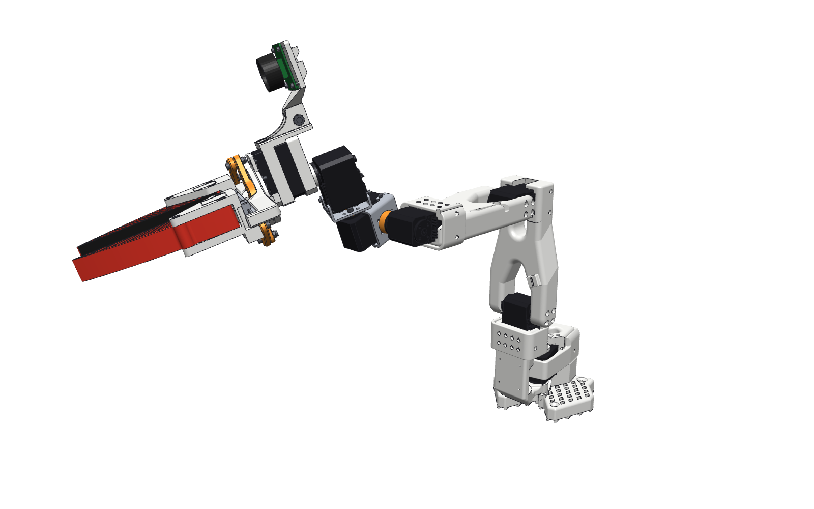
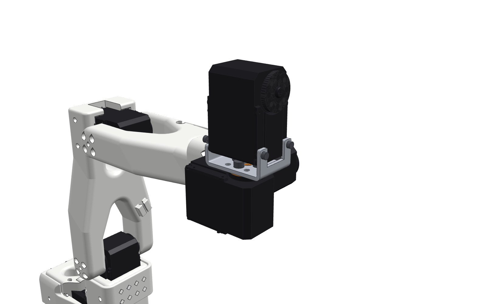
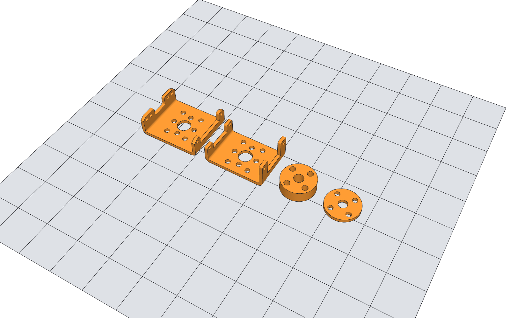
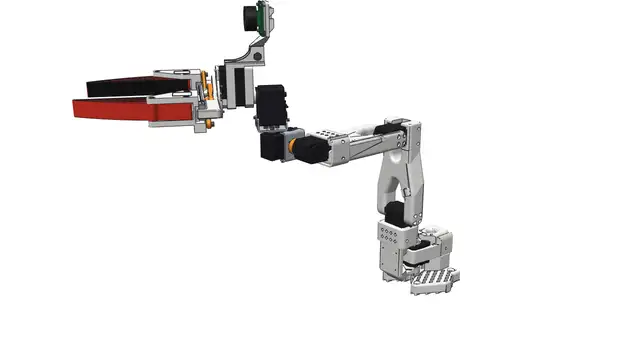

# solarian-arm1

solarian-arm1 is a 6-DOF arm module for Solarian. It is a modification of an
existing open-source arm, the [SO-100 by The Robot Studio](https://github.com/TheRobotStudio/SO-ARM100).
The mod adds one degree of freedom in the wrist, a yaw joint the original design
does not have. Joints use Feetech STS servos
(`shoulder_pan`, `shoulder_lift`, `elbow_flex`, `wrist_flex`, `wrist_yaw`,
`wrist_roll`). The gripper is a separate module — typically
`[solarian-gripper1](https://github.com/solarian-dev/solarian-gripper1)`,
mated flange-to-flange.

## Build your own



solarian-arm1 is an SO-100 up to the forearm, with a new wrist: the wrist flex
drives a side bracket, a new yaw servo sits in it, and an end bracket carries
the roll servo. Everything you need to build it: the parts to buy, the parts to
print, and an animated step-by-step [assembly guide](docs/assembly.md) for the
wrist.


|                                                  |                                                                                                    |
| ------------------------------------------------ | -------------------------------------------------------------------------------------------------- |
| 🛒 [Sourcing parts](#sourcing-parts)             | bill of materials with US and EU links                                                             |
| 🖨️ [Printing the parts](#printing-the-parts)    | stock SO-100 prints + the new wrist parts                                                          |
| 🔧 [Assembly guide](docs/assembly.md)            | the wrist in 7 steps, each with an animation ([full video](docs/media/assembly/assembly_full.mp4)) |
| 📐 [STEP](STEP/solarian-arm1.step) / [STL](STL/) | CAD of the arm and print-ready wrist parts                                                         |




### Sourcing parts

Prices are rough (November 2026) and per arm. Links point to a specific listing
where we have one and to a store search otherwise, so check the listing
matches the spec before you order. The gripper has its own BOM in
[solarian-gripper1](https://github.com/solarian-dev/solarian-gripper1#sourcing-parts).

#### Servos and electronics


| Part                                                                                                             | Qty   | ≈ Price | Buy (US)                                                                                                                                                                                                                                        | Buy (EU)                                                                                                                                                                                                                                             |
| ---------------------------------------------------------------------------------------------------------------- | ----- | ------- | ----------------------------------------------------------------------------------------------------------------------------------------------------------------------------------------------------------------------------------------------- | ---------------------------------------------------------------------------------------------------------------------------------------------------------------------------------------------------------------------------------------------------- |
| **Feetech STS3250** servo, 12 V, 50 kg·cm (C001): shoulder pan, shoulder lift, elbow flex, wrist flex (IDs 1–4)1 | 4     | $125    | [OpenELAB](https://openelab.io/products/feetech-sts3250-c001-ttl-servo) · [Amazon](https://www.amazon.com/s?k=Feetech+STS3250+12V+servo)                                                                                                        | [OpenELAB](https://openelab.io/de/products/feetech-sts3250-c001-ttl-servo) · [Amazon.de](https://www.amazon.de/s?k=Feetech+STS3250+Servo)                                                                                                            |
| **Feetech STS3215** servo, 12 V, 1/345 (C018): wrist yaw, wrist roll (IDs 5–6)                                   | 2     | $28–49  | [OpenELAB](https://openelab.com/products/feetech-sts3215-c018-servo-12v) · [RobotShop](https://robotshop.com/products/feetech-12v-30kgcm-magnetic-encoding-servo-sts3215) · [Amazon](https://www.amazon.com/s?k=Feetech+STS3215+12V+30kg+servo) | [RobotShop EU](https://eu.robotshop.com/products/feetech-12v-30kgcm-magnetic-encoding-servo-sts3215) · [OpenELAB](https://openelab.io/de/products/feetech-sts3215-c018-servo-12v) · [Amazon.de](https://www.amazon.de/s?k=Feetech+STS3215+12V+servo) |
| STS3215 sheet-metal brackets: 1× side bracket, 1× end bracket2 OR 3D printed versions (see below)                | 1 + 1 | $5–16   | [Amazon](https://www.amazon.com/s?k=STS3215+servo+metal+bracket) · [AliExpress](https://www.aliexpress.com/w/wholesale-STS3215-bracket.html)                                                                                                    | [Amazon.de](https://www.amazon.de/s?k=STS3215+Servo+Halterung+Metall) · [AliExpress](https://www.aliexpress.com/w/wholesale-STS3215-bracket.html)                                                                                                    |
| Waveshare Bus Servo Adapter (A)                                                                                  | 1     | $5–11   | [Waveshare](https://www.waveshare.com/bus-servo-adapter-a.htm) · [Amazon](https://www.amazon.com/s?k=Waveshare+serial+bus+servo+driver+board+ST+SC)                                                                                             | [Waveshare](https://www.waveshare.com/bus-servo-adapter-a.htm) · [Amazon.de](https://www.amazon.de/s?k=Waveshare+Bus+Servo+Adapter)                                                                                                                  |
| 12 V DC power supply, 5.5 × 2.1 mm plug, ≥ 10 A3                                                                 | 1     | $20–30  | [Amazon](https://www.amazon.com/s?k=12V+10A+power+supply+5.5x2.1mm)                                                                                                                                                                             | [Amazon.de](https://www.amazon.de/s?k=Netzteil+12V+10A+5%2C5x2%2C1)                                                                                                                                                                                  |
| USB-C cable (adapter → computer)                                                                                 | 1     | $5      | [Amazon](https://www.amazon.com/s?k=USB+C+cable)                                                                                                                                                                                                | [Amazon.de](https://www.amazon.de/s?k=USB+C+Kabel)                                                                                                                                                                                                   |
| Table clamps                                                                                                     | 2     | $5      | [Amazon](https://www.amazon.com/s?k=table+clamp+woodworking+6+inch)                                                                                                                                                                             | [Amazon.de](https://www.amazon.de/s?k=Schraubzwinge+Tisch)                                                                                                                                                                                           |


#### Fasteners

The stock SO-100 part of the arm only uses the screws that come in the servo
boxes. The new wrist adds:


| Fastener                                                         | Qty | Where                                                      |
| ---------------------------------------------------------------- | --- | ---------------------------------------------------------- |
| M3×12 socket head screw                                          | 4   | side bracket + 7 mm spacer → wrist-flex horn               |
| M3×6 socket head screw                                           | 4   | end bracket + 2 mm spacer → wrist-yaw horn                 |
| M2×6 screw (socket head, or the servo box's self-tapping screws) | 8   | yaw servo → side bracket (4), roll servo → end bracket (4) |


| Kit                                   | ≈ Price | Buy (US)                                                                         | Buy (EU)                                                                                 |
| ------------------------------------- | ------- | -------------------------------------------------------------------------------- | ---------------------------------------------------------------------------------------- |
| M2 socket head screw assortment       | $10     | [Amazon](https://www.amazon.com/s?k=M2+socket+head+cap+screw+assortment+kit)     | [Amazon.de](https://www.amazon.de/s?k=M2+Zylinderkopfschrauben+Sortiment+Innensechskant) |
| M3 socket head screw + nut assortment | $12     | [Amazon](https://www.amazon.com/s?k=M3+socket+head+cap+screw+nut+assortment+kit) | [Amazon.de](https://www.amazon.de/s?k=M3+Zylinderkopfschrauben+Muttern+Sortiment)        |


Each servo box has a horn and its centre screw; the wrist uses three of them
(flex, yaw, roll).

#### Filament


| Part                                                                         | Qty | ≈ Price | Buy (US)                                                    | Buy (EU)                                                      |
| ---------------------------------------------------------------------------- | --- | ------- | ----------------------------------------------------------- | ------------------------------------------------------------- |
| PLA+ filament, 1 kg spool (plenty for the SO-100 prints and the wrist parts) | 1   | $20     | [Amazon](https://www.amazon.com/s?k=PLA%2B+filament+1.75mm) | [Amazon.de](https://www.amazon.de/s?k=PLA%2B+Filament+1%2C75) |


**Total:** about **$640–710** for the arm with STS3250s on the first four
joints. The gripper is extra.

**Tools:** hex keys 1.5 / 2.5 mm, a small Phillips screwdriver.

1 The STS3250 has the same body and mounting as the STS3215, so it
drops into the stock SO-100 prints. The wrist flex carries more than on the
SO-100 (the yaw servo and both brackets), which is why it gets the bigger
servo. An all-STS3215 arm assembles the same way with less torque.  

2 Some Feetech STS kits include these brackets. You can also print
them: `[STS3215_Side_bracket.stl](STL/Individual/STS3215_Side_bracket.stl)`,
`[STS3215_End_bracket.stl](STL/Individual/STS3215_End_bracket.stl)`. Check the
bracket matches the drawing before you buy: a flat plate with the 14 mm
horn cross, an 8 mm centre hole and two flanges (side bracket) or four tabs
(end bracket).  

3 All servos on one 12 V bus, gripper included: don't mix 7.4 V and
12 V servos. The STS3250 can draw about 4 A at stall, so size the supply for
several joints loading at once.

### Printing the parts



#### The stock SO-100 parts

Print the SO-100 **follower** parts from The Robot Studio's
[SO-ARM100 repo](https://github.com/TheRobotStudio/SO-ARM100/blob/main/SO100.md#printing-the-parts),
with their settings, **except** the three wrist and jaw parts this arm
replaces:

- `Wrist_Roll_Pitch_08i`
- `Wrist_Roll_08c`
- `Moving_Jaw_08d`

Their all-in-one plates include those three, so either print the individual
files in
`[STL/SO100/Individual/Follower](https://github.com/TheRobotStudio/SO-ARM100/tree/main/STL/SO100/Individual/Follower)`
without them, or delete them from the plate in your slicer.

#### The new wrist parts

All STLs are already **rotated into their print orientation**. Print the
ready-made plate
`[STL/Plates/arm1_wrist_parts_plate_220x220.stl](STL/Plates/arm1_wrist_parts_plate_220x220.stl)`,
or the individual parts in `[STL/Individual](STL/Individual)`:


| Part                                                                  | Qty | Material     | Supports | Notes                                              |
| --------------------------------------------------------------------- | --- | ------------ | -------- | -------------------------------------------------- |
| `[horn_spacer_7_mm.stl](STL/Individual/horn_spacer_7_mm.stl)`         | 1   | PLA          | no       | wrist flex horn → side bracket; 100 % infill       |
| `[horn_spacer_2_mm.stl](STL/Individual/horn_spacer_2_mm.stl)`         | 1   | PLA          | no       | wrist yaw horn → end bracket; 100 % infill         |
| `[STS3215_Side_bracket.stl](STL/Individual/STS3215_Side_bracket.stl)` | 1   | PETG or PLA+ | no       | only if you don't have the metal one; 100 % infill |
| `[STS3215_End_bracket.stl](STL/Individual/STS3215_End_bracket.stl)`   | 1   | PETG or PLA+ | no       | only if you don't have the metal one; 100 % infill |


Nozzle 0.4 mm, 0.2 mm layers, 3+ walls. The brackets are drawn as 2 mm sheet
metal. Printed at 2 mm they are much weaker than aluminium, so print them
solid and check them for cracks after the first runs. Prefer the metal ones on
the wrist flex if you have them.

### Assembly

The base, shoulder, upper arm and forearm are the stock SO-100: follow
[the SO-100 assembly video](https://www.youtube.com/watch?v=FioA2oeFZ5I) up to
the wrist-flex servo. Then follow the [wrist assembly guide](docs/assembly.md):
7 short steps, each with an animation rendered from the CAD. The whole build
as one video: `[assembly_full.mp4](docs/media/assembly/assembly_full.mp4)`.



The animations, print orientations and plates are generated from the Onshape
assembly by `[tools/assembly_render](tools/assembly_render/README.md)`, so they
can be regenerated whenever the CAD changes.

## Installation

```bash
pip install -e plugins/solarian-feetech
pip install -e plugins/solarian-arm1
```


## Module


| Entry point | Class        | Role                         |
| ----------- | ------------ | ---------------------------- |
| `arm-1`     | `Arm1Module` | 6 joints + Mink IK (`x..rz`) |


Default YAML lives at `solarian_arm1/conf_arm.yaml`. Copy it into a project's
`conf/` (for example `right_arm.yaml`) and set the serial port / servo ids.

```python
from solarian.core.robot import Robot
from solarian.sim import SceneConfig, ModuleAttachment
from solarian_arm1 import ARM_MJCF_PATH
from solarian_arm1.arm import Arm1Module
from solarian_gripper1 import MJCF_FEETECH_PATH as GRIPPER_MJCF
from solarian_gripper1.gripper_feetech import Gripper1FeetechModule

class Arm1Robot(Robot):
    right_arm = Arm1Module(ik_tcp=Gripper1FeetechModule.tcp_from_flange)
    right_gripper = Gripper1FeetechModule()
    scene = SceneConfig(
        attachments=[
            ModuleAttachment(
                module="right_arm",
                mjcf=ARM_MJCF_PATH,
                prefix="right/",
            ),
            ModuleAttachment(
                module="right_gripper",
                mjcf=GRIPPER_MJCF,
                parent_site="right/flange",
                child_site="flange",
                prefix="right_gripper/",
            ),
        ],
    )
```

The arm MJCF exports a `flange` site (CAD Frame). Attach a gripper by aligning
both models' `flange` frames. IK tracks `flange` plus the tool's
`tcp_from_flange` offset (CAD `tcp` in the gripper's mate frame). The scene
still attaches the gripper MJCF for physics and cameras.

## License

[Apache License 2.0](LICENSE). Copyright 2026 PrimaryKey Inc. The mechanical
design and meshes in `solarian_arm1/assets/` are derived from the
[SO-ARM100](https://github.com/TheRobotStudio/SO-ARM100) by The Robot Studio
(Apache 2.0) and modified; see [NOTICE](NOTICE). The hardware files (`STL/`,
`STEP/`, `docs/media/`, `tools/assembly_render/cad/`) are under the same
license. solarian-arm1 is not
affiliated with, sponsored by, or endorsed by The Robot Studio or Hugging Face.

Solarian, Solarian Arm and the Solarian logo are trademarks of PrimaryKey Inc.
See the [trademark policy](https://github.com/solarian-dev/solarian/blob/main/TRADEMARKS.md).