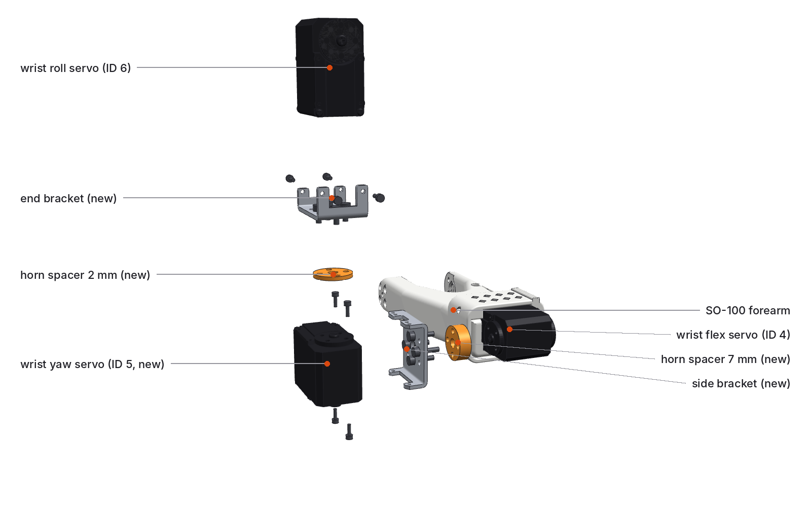
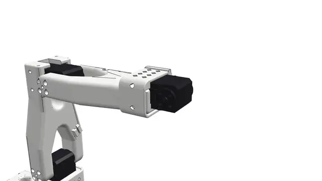
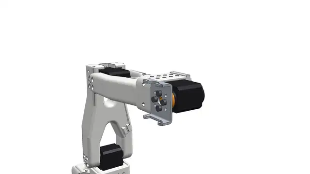
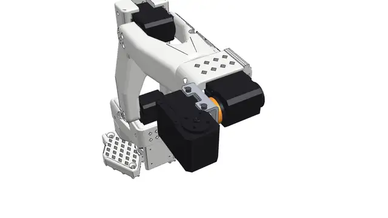
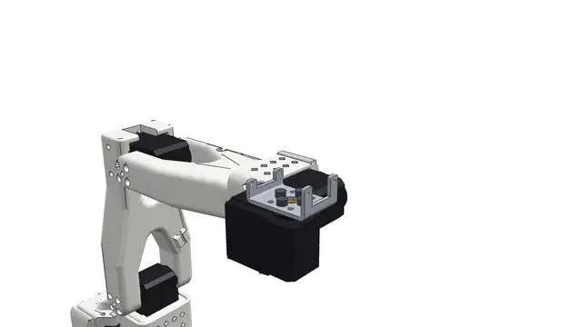
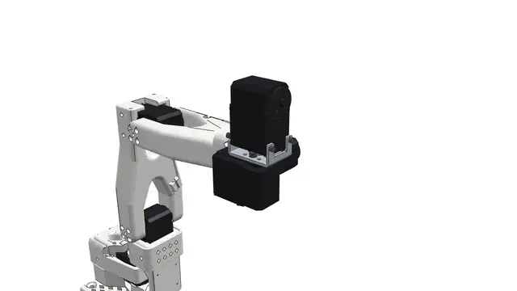
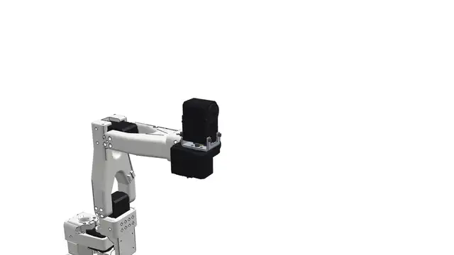
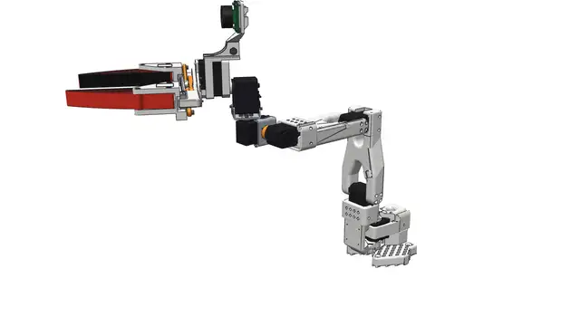

# Assembling solarian-arm1: the wrist

solarian-arm1 is an [SO-100](https://github.com/TheRobotStudio/SO-ARM100) with
one extra joint in the wrist. Everything from the base to the forearm is the
stock SO-100 and is built the same way. This guide covers what changes: the
wrist flex, the added wrist yaw, the wrist roll and the parts that join them.
Get the parts first ([Sourcing parts](../README.md#sourcing-parts)) and print
the new ones ([Printing the parts](../README.md#printing-the-parts)).

Every step has a short animation rendered from the Onshape assembly. The full
build is also one video:
[`media/assembly/assembly_full.mp4`](media/assembly/assembly_full.mp4). Each
step's clip is in [`media/assembly/`](media/assembly/) as `.mp4`.

> **Fasteners.** The CAD has no screws modelled; the screws in the
> animations are drawn in to show where each one goes.

**Tools:** hex keys 1.5 / 2.5 mm (or the Phillips driver that matches your
screws), a small Phillips screwdriver for the horn centre screws, and a
computer with the Waveshare bus servo adapter to set servo IDs.

## What changes from the SO-100

| | SO-100 | solarian-arm1 |
| --- | --- | --- |
| Wrist flex servo (ID 4) | STS3215 in the forearm | **STS3250** in the same place in the forearm: it now carries one more servo and two brackets |
| Wrist flex output | horn drives the printed `Wrist_Roll_Pitch` link | horn drives a **7 mm horn spacer** and an **STS3215 side bracket** |
| Wrist yaw (ID 5) | — | **new STS3215**, screwed into the side bracket, output facing up |
| Yaw → roll | — | **2 mm horn spacer** and an **STS3215 end bracket** on the yaw horn |
| Wrist roll (ID 6) | STS3215 in `Wrist_Roll_Pitch` | STS3215 standing in the end bracket, output facing forward |
| Tool | printed fixed jaw + moving jaw + gripper servo | the roll horn is the `flange`; [solarian-gripper1](https://github.com/solarian-dev/solarian-gripper1) bolts to it |

So you skip three SO-100 follower prints: `Wrist_Roll_Pitch_08i`,
`Wrist_Roll_08c` and `Moving_Jaw_08d`.

The side and end brackets are the standard sheet-metal STS3215 brackets. Some
Feetech STS kits include them; you can also print them from
[`STL/Individual`](../STL/Individual). Both have the STS3215 horn pattern (four
holes on a 14 mm cross), a diagonal hole pattern, and an 8 mm hole in the
middle so you can still reach the horn's centre screw.

## Before you start: prepare the three wrist servos

Do this for the wrist flex (ID 4), wrist yaw (ID 5) and wrist roll (ID 6)
servos, one at a time, alone on the bus:

1. Run `solarian calibrate-servo` (see
   [Calibration](https://github.com/solarian-dev/solarian/blob/main/docs/modules/calibration/page.mdx)).
   It sets the ID (the `id` in `conf_arm.yaml`: 4, 5, 6), resets the position
   registers and parks the shaft at mid-encoder (2048).
2. Press the horn onto the spline and screw in its centre screw.

The CAD pose (all joints at zero) is mid-travel. Fit each bracket below so the
wrist looks like the animation while the servos are still parked at 2048.
That keeps every joint's travel away from the encoder's 0/4095 seam. The
bracket holes repeat every 90°, so pick the position that matches the picture.

---

## Step 1: Build the SO-100 up to the forearm

| Parts | Fasteners |
| --- | --- |
| SO-100 follower prints except the three wrist/jaw parts, 3× STS3250 (IDs 1–3), STS3250 wrist flex servo (ID 4) | the screws in the servo boxes |

Follow the [SO-100 assembly video](https://www.youtube.com/watch?v=FioA2oeFZ5I)
from the base up to the forearm, including the wrist-flex servo in the end of
the forearm. Two differences:

- Use STS3250 servos for shoulder pan, shoulder lift, elbow flex and wrist
  flex (IDs 1–4). They have the same body and mounting as the STS3215.
- Stop when the wrist-flex servo is in the forearm with its horn fitted. Don't
  fit `Wrist_Roll_Pitch`.

## Step 2: Fasten the 7 mm spacer and side bracket to the wrist-flex horn

| Parts | Fasteners |
| --- | --- |
| `horn_spacer_7_mm`, STS3215 side bracket | 4× M3×12 socket head |

Hold the 7 mm spacer against the wrist-flex horn and the side bracket's flat
face against the spacer, flanges pointing away from the forearm. Put the four
M3×12 screws through the bracket's cross-pattern holes and the spacer into the
horn. Do this before the yaw servo goes on: the screw heads end up between the
bracket and the yaw servo, so they can't be reached afterwards.

The bracket's flanges should run along the forearm, as in the animation, with
the servo still at 2048.

## Step 3: Screw the yaw servo into the side bracket

| Parts | Fasteners |
| --- | --- |
| STS3215 wrist yaw servo (ID 5) | 4× M2×6 (two per flange) |

Slide the yaw servo in between the bracket's two flanges with its output (horn)
facing up, then screw it down: two screws through the bottom flange into the
servo's lower mounting holes, two through the top flange into the upper ones.

## Step 4: Fasten the 2 mm spacer and end bracket to the yaw horn

| Parts | Fasteners |
| --- | --- |
| `horn_spacer_2_mm`, STS3215 end bracket | 4× M3×6 socket head |

Lay the 2 mm spacer on the yaw horn and the end bracket on the spacer, tabs
pointing up. Screw it down with four M3×6 through the cross-pattern holes into
the horn. Line the tabs up with the forearm, as in the animation. Again, the
screw heads end up under the next servo, so they go in now.

## Step 5: Screw the roll servo into the end bracket

| Parts | Fasteners |
| --- | --- |
| STS3215 wrist roll servo (ID 6), with its horn | 4× M2×6 (one per tab) |

Lower the roll servo between the end bracket's four tabs, horn facing forward
(away from the forearm), and screw one M2×6 through each tab into the servo's
mounting holes.

## Step 6: Wire it and check the wrist by hand

Daisy-chain the bus through the wrist: elbow (3) → wrist flex (4) → wrist yaw
(5) → wrist roll (6), and on to the gripper. Leave a loose loop of cable at the
flex and at the yaw so neither goes tight at the end of its travel. The roll is
continuous, so route its cable to the gripper (not around the roll axis)
and keep the gripper cable clear of the roll horn.

With the bus unpowered, move each wrist joint by hand: flex, then yaw, then
roll. Nothing should rub and no cable should pull.

## Step 7: Mount the gripper

| Parts | Fasteners |
| --- | --- |
| [solarian-gripper1](https://github.com/solarian-dev/solarian-gripper1) with its arm adapter (`feetech_back_holder_to_horn`, `horn_spacer_3.5_mm`) | 4× M3×10, 4× M2×6 (from the gripper's BOM) |

The roll horn is the arm's `flange`. Follow
[step 12 of the gripper guide](https://github.com/solarian-dev/solarian-gripper1/blob/main/docs/assembly.md#step-12--fit-the-arm-adapter):
screw the adapter and 3.5 mm spacer to the roll horn first (4× M3×10, the heads
sit inside the adapter), then fit the gripper onto the adapter (4× M2×6). Give
the gripper servo its own ID on the shared bus (7 in the Solarian docs).

## Done

The wrist now flexes, yaws and rolls on three servos. Next:

1. Copy `solarian_arm1/conf_arm.yaml` into your project's `conf/` and set the
   port.
2. Run `solarian calibrate` on the arm: joint limits, then the home pose (the
   CAD pose above), then the sim direction check. `wrist_roll` is continuous,
   so it has no limit sweep.

---

### Regenerating these animations

The animations, stills and print-oriented STLs are generated from the Onshape
assembly by [`tools/assembly_render`](../tools/assembly_render/README.md).
